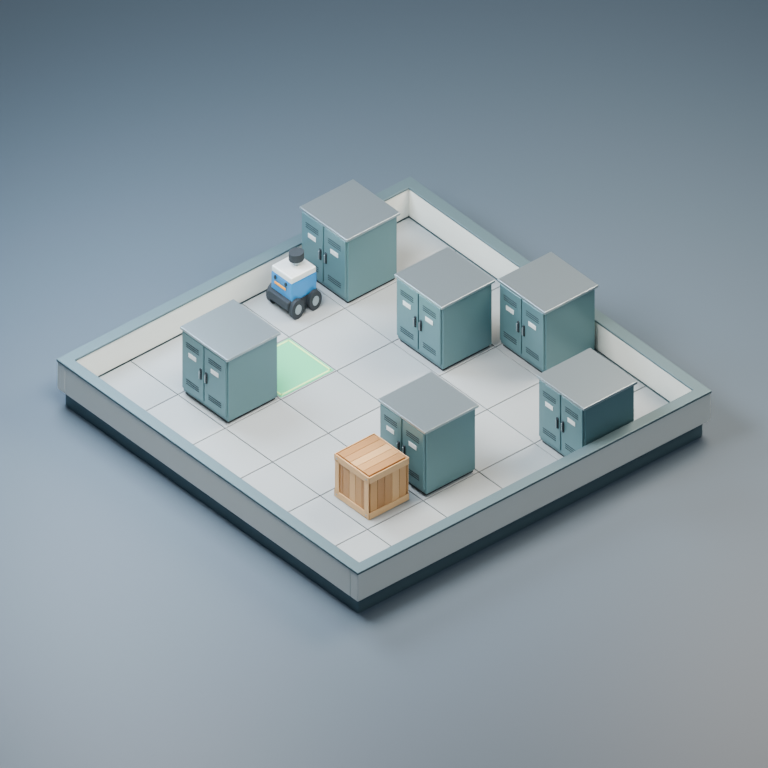

# Scene-RSI V0 — 3D 场景生成基线与独立验证器

## M2/M3 重复配对：尚无完整有效改进

从 `2bb85f6` 冻结策略、后端及评价，两新初始程序各做两次 K=1 配对。8 个正式尝试中 5 个完成代码编辑和隔离评价，3 个被上游容量 429 拒绝，不补抽；5 个候选均未通过选择集，双方最终 MetaImp@1 为 0。M3 两个原始候选通过私有终测联合门槛，但不能据此补选，第二初始程序也缺少 M3 结果。离线机制检查及两次独立开发消融证实研发输入会变化，未证明成本合理的算法收益，不生成 M4。268 项测试通过；本轮 10 次 CLI 尝试、24 个服务请求、已知下界 358,028 Token，另 3 个请求用量未知；历史创建 77,723 Token 单列。逐轨迹、真实补丁/事件、隐私检查和复现见 [实验报告](experiments/m3_validation/README.md)。

## M3 原生补丁恢复：资格通过，完成固定对照

从`8b40fa0`最小修复原生补丁用法及故障留存，一次新构建成功产生M3，原21组资格检查通过；随后四个K=1候选均完成审计和隔离运行。第一组M3终测48/48、偏好误差.467→.347m且通过多目标门槛；M2误差更低但硬成功47/48。第二组均未入选，不能证明M3普遍优于M2。252项测试、8项隔离验收通过；本轮5个编码任务、302,093 Token。实际Diff、17份服务SSE、全部dev/val对照及私有终测汇总见[修复与实验报告](experiments/m3_patch_fix/README.md)。

## M3 编码接口：响应截断已修复，单次新构建仍失败

离线确认4,096来自后端显式响应额度，仅提高至16,384并补齐失败Diff留存。唯一一次新构建的第五响应完整输出4,893 Token，验证截断解除；但原生补丁格式被拒绝，随后本地请求门槛阻止继续，未产生实际修改。消耗126,344 Token、143.73秒后停止，未进入资格或M2/M3对照。251项测试、8项隔离回归及两种原生CLI离线验收通过；没有M3能力结论。证据、不确定性与复核见[修复报告](experiments/m3_response_fix/README.md)。

## 证据驱动 M2→M3：原生编辑未完成

从 `bfa608e` 登记共同四种子适配、Probe真实交付资格和两份新初始程序。唯一一次策略编辑的第五个服务响应触发4,096输出Token上限，未产生补丁；保留123,515Token成本与JSONL后停止，资格/独立对照均未进入，未生成M3或M4。249项测试、8项真实隔离回归及原生编辑离线验收通过，不能据此判断M3是否优于M2。详见 [实际失败记录与复现](experiments/evidence_m3/README.md)。

## M2 开发机制消融与多目标方法建议

从 `46d87dc` 固定开发条件/种子，完成 112 次隔离生成和 32 次最终筛选重评分，无新模型提案。重采样维持位置变化，最终单布局 loss 选优存在分布权衡；去初始随机朝向改善部分可见性却降低旋转变化。执行路径显示历史退化被当成当前瓶颈，probe 新例子未进入后端；不能据此单独解释全部跨任务退化。242 项测试与 8 项真实隔离回归通过，M0/M1/M2 和评价均未改动。结果、机制证据及未执行的 M2→M3 最小方案见 [研究报告](experiments/m2_attribution/README.md)。

## M1→M2：真实程序修订，未证明元能力提升

从本地 `526a309` 零调用分析旧 dev 失败，一次原生编辑产生并冻结 M2，实际修改缺口诊断、探测和示例决策逻辑。一个新 group-restart 初始程序和 28 个新条件上，M0/M1 的候选入选并通过终测多目标门槛，M2 未入选。M2 原始终测偏好误差最低、硬成功 24/24、位置多样性超过基线，但可见性损失超出冻结门槛，不补选。共四个编码任务、333,620 Token；236 项测试重跑通过，224 状态重评分完全一致，旧配额测试的时序失败日志保留。详见 [实验报告](experiments/m2_failure/README.md)。

## 两组 Repair 多目标配对：未发现 M1 优势

从 `0e30ebb` 冻结 M0/M1、原生编辑和评分规则，完成两组独立 K=1 配对、四个真实提案。四候选均通过审计与隔离执行，但验证接受率和新私有终测多目标通过率均为 0/2（M0）、0/2（M1）。两者降低偏好误差却损失位置多样性，最终都保留 Repair；M1 用量 150,216、M0 为 91,804 Token。本轮共 242,020 Token，230 项测试通过，不追加提案、不运行 M2。详见 [配对实验报告](experiments/paired_repair/README.md)。

## 连续布局：原生 Codex 工作区编辑

从 `9377e67` 接入中立的改进任务 → Git 补丁接口，冻结 M0/M1 和全部评分规则。一次不计分测试通过后，四组 K=1 均完成原生编辑、静态审计和受限执行。仅 M1/Repair 在选择集入选；终测偏好误差 .314→.125m、硬成功 23/24→24/24，但位置多样性下降，未保持完整多目标收益，不能证明元策略优势或 RSI。227 项测试通过；真实补丁、JSONL、完整 Token 统计和复现见 [实验报告](experiments/native_codex/README.md)。

## 连续布局 M0/M1：首轮调用未完成提案

从 `64ab246` 冻结 Benchmark 和元策略，建立共同的 24 查询受限适配，16/16 与原基线姿态一致。实际四次 Codex 调用均在 180 秒时限内未完成提案，Token 用量缺失；没有候选算法、K=2 或 M2，无法判断 M0/M1 改进能力。新私有测试两种初始算法均为 23/24；222 项测试及 112 条重评分通过。协议、真实调用记录、成本和限制见 [实验报告](experiments/continuous_meta/README.md)。

## 连续 Mesh Benchmark：本轮仅评价固定基线

从 `1706a0a` 新增连续 xyz/Euler、实际 Mesh 联合碰撞、接触/重力、Mesh 像素可见性与多目标评价，保留历史任务不变。独立终测随机/修复/联合优化为 11/24、23/24、24/24；联合优化的空间偏好误差较修复法降低 .147m，但硬成功率仍近天花板。214 项测试，120 条重评分一致，5 个 A100/Blender 场景及 15 张实际渲染；隐藏任务和参考解仅在服务器私有目录。本轮模型调用为 0，详见 [研究报告](experiments/continuous_mesh/README.md)。

## 3D 支撑、房间与可见性任务：元策略机制可行性实验

从 `766382c` 扩展高度/支撑、两房间通行和固定相机可见性，保留原始数据语义与 Verifier。四组冻结策略共 8 次真实 Codex 调用，6 个审计通过候选全部在 selection 18/18、test 27/27；首轮探测全部 random，差异来自一次超时和一次语法错误。M0/M1 原始组 MetaImp 均为 .963，仍不能证明元策略优势，已提前停止新调用，未启动 M2。202 项测试、真实三维渲染、成本、停止规则偏离与复现见 [研究记录](experiments/spatial_probe/README.md)。

## 固定 M0/M1 的室内约束 MetaImp 对照

从 `5261b1f` 冻结两种元策略，新增固定入口/目标、空间关系与最短路径下限任务。三个初始程序各做两次采样，实际完成 36 次提案；29 个完整代码全部通过审计。终测 MetaImp@2 的 M0/M1 为 0.7986/0.9722，@3 为 0.8125/0.9722。差异已不来自静态拒绝，但主要受一条 M0 连续失败轨迹影响；可用布局仍近满分，不能据此确认 M1 普遍更强。187 项测试、成本下界及缺失用量、流中断敏感性与复现命令见 [实验记录](experiments/meta_hard/README.md)。

## 独立泛化与最小 MetaImp@1

冻结 `b83b104` 算法，新地图中有 150 张可行、42 张不可行；原始/冻结算法首次可解数为 25/150 与 150/150，没有可解性拒绝采样。另完成一次真实 Codex 元策略程序修订和两个保留初始生成器的配对实验：MetaImp@1 为 0.50/0.8125，但差异全部来自原策略一次保守静态审计拒绝，尚不能证明更强的算法改进能力或完整 RSI。176 项测试、384 条离线重放一致、12 张 A100/Blender 实际渲染及全部六次调用记录见 [研究记录](experiments/generalization_meta/README.md)。

## 第一次真实 Codex 算法改进

从 `19bb4db` 完成 3 次真实模型提案，2 个候选通过受限评估、1 个静态拒绝；自动选择候选 1。关闭 `require_solvable` 后 dev 从 26/96、val 从 19/96 均提升至 96/96；同障碍地图的一次输出检查也通过。收益伴随更多计算、较短路线和位置多样性变化，不是 RSI。完整审计、成本、复现命令及 18 张 A100/Blender 对照图见 [实验记录](experiments/first_algorithm/README.md)。旧生成器继续作为基线，选定算法使用受限入口生成。

## Blender 真实 Mesh 与三视图导出

新增固定资产库与可选 Blender 导出器：保留现有任务和独立评价，生成 `.blend`、`.glb` 及三个固定相机图像。已用现有 Blender 4.2.0 和 A100 实际渲染三个自动生成场景；CPU 回退也已实测。接口、复现命令、结果与限制见 [RENDERING.md](RENDERING.md)，实际文件在 [examples/rendered](examples/rendered)。



## Interactive Code World

新增可交互室内推动世界：沿用 SceneSpec、SceneState 和原始 Verifier，使用 **PyBullet 碰撞检查 + CPU TinyRenderer 三维渲染**。支持键盘移动、推动方块、障碍碰撞、目标完成、轨迹导出，以及固定 Agent 与独立可解性搜索。实验仅接受结构化生成器参数，不执行任意模型代码。

```bash
python3.11 -m pip install -r requirements-world.txt
OPENBLAS_NUM_THREADS=1 OMP_NUM_THREADS=1 python3.11 -m scene_rsi.world serve
```

浏览器打开 `http://127.0.0.1:8765`；远程服务器需要 SSH 端口转发。操作、实验对照、CPU 渲染导出和限制见 [WORLD.md](WORLD.md)。旧静态基准与 Phase 2 接口保留。

## Phase 2 早期交付记录

以下为早期通用候选执行接口的状态。后来的自动算法与元策略实验复用经过验收的单进程 Apptainer + seccomp 窄接口，见上方研究记录；没有开放任意项目代码或控制器自修改。

Phase 2B 的候选执行器接口、独立评分和离线验证见 [PHASE2B.md](PHASE2B.md)。当前未发现可验收的隔离服务，候选执行继续 fail-closed；没有真实动态对照结果。

本分支只交付 **P2A 安全设计与离线测试**。现有环境缺少已验证的隔离后端、资源委派与模型凭据代理；真实 Codex 调用和候选执行继续 fail-closed。没有新的候选 dev/val 成绩或 RSI 证据。接口、能力探测、预算登记和可复现命令见 [PHASE2.md](PHASE2.md)。Phase 1 基线仍为 `f116002`，其原工作树与协议保留。

## 第一阶段新增：可复现 Benchmark 与 Fixed Meta-Agent 接口

本次在原始 V0 上新增任务生成、独立划分、统计和离线补丁审计。详细接口、隔离边界与运行方法见 [PHASE1.md](PHASE1.md)。**没有实现 Meta-Agent 自修改，也不把场景修复或固定改进器称为 RSI。**

在当前共享服务器上，从本项目目录运行（Python 3.10+，仅标准库、CPU）：

```bash
SCENE_RSI_PYTHON=/home/xymo/miniforge3/bin/python bash scripts/reproduce.sh ../phase1_run 20261023 4
```

该命令运行测试、生成每族 4 个任务、评测 dev/val 和原始样例、导出 dev-only 请求包。输出目录必须是新的，源码 Git 工作树须干净；**不会运行保留测试集或调用 Codex 模型**。系统 `/usr/bin/python3` 为 3.8，不满足原项目要求。

`SceneSpec`、几何定义、`SceneVerifier` 及原始测试逐字节保留，`original_contract.json` 保存其 SHA-256。新增 CLI 可运行 `python -m scene_rsi check-integrity` 检查。下面保留 V0 的背景说明；原始测试实测为 **17 项**，下文旧数字已校正。

> **版本定位：这是 Scene-RSI 的实验地基，不是已经实现的 RSI。** 当前不存在 LLM、Meta-Agent、跨代自修改或模型训练。代码专门为后续引入这类机制提供一个可复现、可验证的任务环境。

## 已实现

- `SceneSpec`：从 JSON 描述房间尺寸、固定资产、物体、空间约束、门口区域及通行要求。
- `FixedSceneAgent`：无学习、无模型调用的确定性布局基线（可替换）。
- `SceneVerifier`：**独立于 Agent** 的硬约束验证器，检查物体存在性、尺寸/边界、非法碰撞、`near_wall`、参考物体朝向下的 `in_front_of`、`keep_clear` 与粗粒度路径可达性。
- `scene_state.json`：机器可读结果；`evaluation.json`：结构化错误清单。
- `floorplan.svg`：二维俯视图；`scene.obj` + `scene.mtl`：可以导入 Blender 的**三维长方体代理几何**（不是精细物体模型）。
- 原始 17 项自动测试，8 个基础场景，以及一个**明确可行但固定基线失败**的挑战样本；第一阶段另有新增测试。

## 快速开始

要求 Python **3.10+**，无需 pip 安装第三方包；从本项目根目录运行：

```bash
python -m unittest discover -s tests -v
python -m scene_rsi generate --spec examples/bedroom_001.json --out runs/bedroom_001
python -m scene_rsi benchmark --spec-dir examples --out runs/benchmark_summary.json
python -m scene_rsi benchmark --spec-dir benchmarks/dev --out runs/challenge_summary.json
python -m scene_rsi validate --spec benchmarks/dev/corner_desk_challenge.json --state benchmarks/golden/corner_desk_challenge.state.json
```

- `runs/bedroom_001/scene_state.json` 是固定生成器生成的物体位置与朝向。
- `runs/bedroom_001/evaluation.json` 是独立验证器返回的有效性、评分和错误。
- `runs/bedroom_001/floorplan.svg` 可直接用浏览器打开。
- `runs/bedroom_001/scene.obj` 可在 Blender（File → Import → Wavefront (.obj)）中打开。

## 项目结构

```text
scene_rsi_v0/
├── scene_rsi/
│   ├── schema.py                 # 共享只读数据格式
│   ├── geometry.py               # XY+Z 几何辅助方法
│   ├── agent/fixed_agent.py      # 将来允许 Meta-Agent 修改的任务代码
│   ├── evaluator/verifier.py     # 可信外部评分，禁止 Agent 修改
│   ├── export.py                 # SVG / OBJ 可视化
│   └── __main__.py               # 命令行接口
├── examples/                     # 8 个基础 smoke-test 场景
├── benchmarks/dev/               # 有明确已知缺陷的挑战任务
├── benchmarks/golden/            # 确认可行的挑战任务参考状态
├── tests/                        # 自动化测试
├── runs/                         # 实际运行结果
└── RESEARCH_PROTOCOL.md          # 后续开展 RSI 对照实验的协议
```

## 场景格式：约定非常重要

- 坐标单位为**米**，地面是 `XY` 平面，`Z` 轴向上。
- `SceneState.objects[].x/y` 表示物体**底面中心**；代理几何从 z=0 向上延伸资产高度。
- `yaw_deg` 仅允许 `0, 90, 180, 270`，表示相对于 `Z` 轴的逆时针旋转；资产自身的**前方**定义为本地 `+Y`。
- `assets` 是由外部数据提供的受信任尺寸，不允许未来可变 Agent 为规避验证而修改。
- `near_wall` 测量物体外轮廓与墙面的距离，不是中心距离。
- `in_front_of` 同时检查参考物体前向投影间隙和横向覆盖；不把世界 `-Y` 固定理解为「前面」。
- `regions` 使用矩形的左下角 `x/y` 与 `width/depth`。
- `access_paths` 使用障碍物膨胀后的四连通栅格 BFS，作为近似可通行性检验。

具体样例见 `examples/bedroom_001.json`。

## 本次实际验证结果（仅限自带样例）

| 验证项 | 结果 |
|---|---|
| 原始自动化测试 | 17 / 17 通过 |
| 8 个基础样例 | 8 / 8 满足预定义硬约束 |
| `corner_desk_challenge` | 固定 Agent **未能通过** |
| 同一个挑战的人工构造合法状态 | 验证器 **通过** |

基础样例用于检查**程序能否工作**，不是随机抽样的研究 benchmark，不能据此声称泛化成功率 100%。挑战任务中桌子必须**同时靠近北墙和东墙**；固定基线只按一个靠墙约束放置，因此会失败。这提供了一个可复现的后续算法改进目标。人工构造的合法状态证明这个挑战不是无解任务。

## 与严格 RSI 的关系

真正的 Scene-RSI 实验需要加入可持久修改代码的 `Meta-Agent`，然后让后代 Meta-Agent 在相同预算下从**全新初始生成器**出发改进，量化 `MetaImp@K`。不能把循环移动家具、反复修改单个场景、或固定 Meta-Agent 提升 Scene-Agent 的任务分数称为完整 RSI。

请参阅 `RESEARCH_PROTOCOL.md` 中的对照组、公平性约束和隐藏测试流程。

## 主要限制与下一步

1. **只验证带有固定长方体代理几何的室内布局。** 没有真实资产网格、材质、阴影、物理接触或照片级质量指标。
2. **二维足迹碰撞近似。** 不支持堆叠、悬挂、物理可放置性；栅格 BFS 不等于真实机器人或人体导航。
3. **样例很少且有人工构造偏好。** 最终研究需要自动生成及人工核验的更大任务集、跨场景族 held-out 测试和不重复使用的最终测试集。
4. **没有实际 RSI。** 下一步是在隔离执行环境中添加受约束的代码补丁、版本归档、固定 Meta-Agent 对照和后代 Meta-Agent 的独立 `MetaImp@K` 测试。
5. **验证器必须放在 Agent 无写权限的环境。** 当前目录分区只是示意；真正的研究运行需要容器/进程权限隔离、不可变测试资源、资源限额和审计日志。
