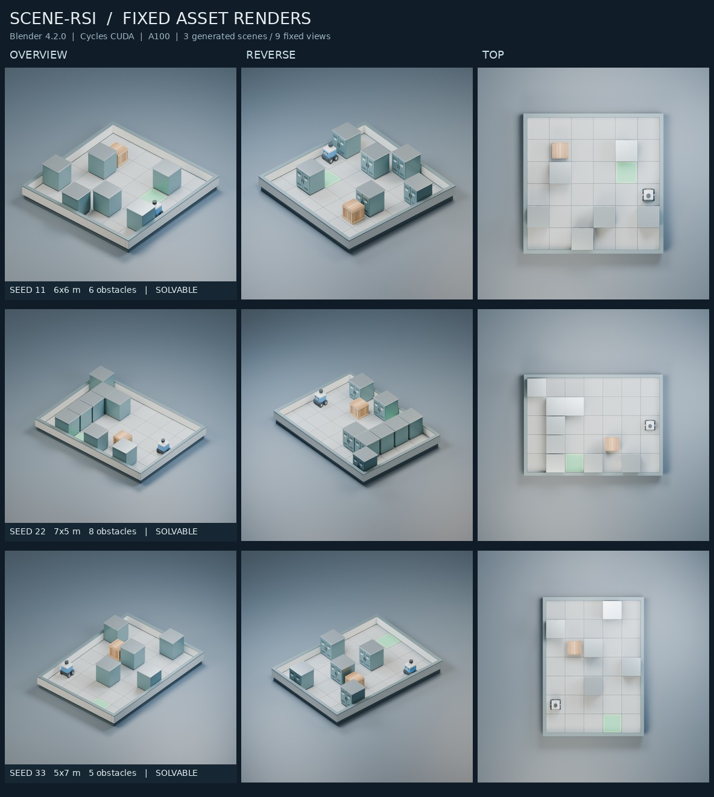

# Actual Blender renders

Three existing-generator samples, produced from baseline `26c130c` using the optional Blender exporter. Nine real Cycles renders, 768×768, 48 samples, Blender 4.2.0 / CUDA / one NVIDIA A100-PCIE-40GB. See [RENDERING.md](../../RENDERING.md) for exact commands and limitations.

| Sample | Room / obstacles | Original geometry | Reference replay in PyBullet | Fixed Agent | Blender export and three views |
|---|---|---|---|---|---|
| [seed 11](seed_11) | 6×6 / 6 | valid | success | success | 13.78 s |
| [seed 22](seed_22) | 7×5 / 8 | valid | success | agent_insufficient | 13.10 s |
| [seed 33](seed_33) | 5×7 / 5 | valid | success | success | 12.82 s |

Every sample directory contains its generated task, independent evaluation/trajectory, `.blend`, `.glb`, three PNGs, renderer log and timing/device records. JSON renderer input contains no reference route. `summary.json` contains the unrounded results. This confirms the visual export path, not an Agent improvement or RSI result.

`checks/` contains the baseline 144-test run, final 151-test run, successful Blender/GLB reimport acceptance, GPU probes and an actual automatic CPU fallback result for Blender 4.2.10's PTX incompatibility with driver 535.247.01. That fallback test used 128×128 / 4 samples; its timing is not comparable with the formal GPU examples.
