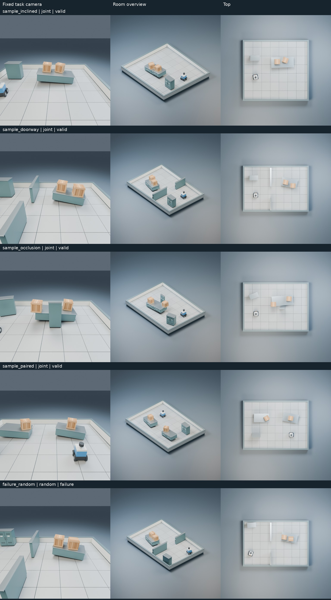

# 连续 Mesh 场景生成 Benchmark

基础提交 `1706a0a`；评价、任务分布和三种算法在 `0bc9ec3` 冻结，之后未根据
验证/终测修改。**本轮未发起 Codex CLI/模型提案调用，没有修改 M0/M1，没有 M2 或 RSI 实验。**



## 两个研究问题

**1. 已包含真实连续三维几何及多目标差异。** 没有有限姿态域、坐标列表或
90 度旋转限制。输出 xyz 与 Euler XYZ 弧度；倾斜支撑使局部连续移动改变 z
和完整三维姿态。评价使用原资产的实际 Mesh 部件联合，并计算真实 Mesh
像素遮挡、空间偏好、物理稳定、通行、多样性及成本。旧 SceneSpec/SceneState、
原 Verifier、旧任务与资产文件不变，SceneSpec 继续承载房间、物体和固定尺寸。

**2. 能区分本次三种简单基线，但还不能据此认定适合元策略评测。**
独立测试的修复法相对随机法，硬成功率提高 50 个百分点，按任务重采样的
95% 区间为 20.8–75.0 个百分点。联合优化相对修复法，空间偏好误差降低
0.1467m（区间 0.1053–0.1876m），通过了终测前固定的最小区分度判据。
更强方法的硬成功率仍近天花板，可见性差异也不足以确认提升。

## 任务和评价

四类任务：斜支撑台、门洞通行、屏风遮挡、双支撑台。房间尺寸、支撑台倾角和
朝向连续变化；包含两个木箱、固定支撑、落地柜和轮式 Agent Mesh。Agent 仅是
待布局的刚体，没有新增机器人任务或训练。支撑台是锚定结构；显示 Mesh 复用
原金属柜的固定尺寸变换，不是新的外部资产库。

输入为 `task = {spec, meshes, fixed, supports, zones, relations, camera,
visibility, entry, goal, family}`。输出为：

```json
{"scene_id":"example","objects":[
  {"id":"box_0","asset":"box","position":[4.1,3.2,1.05],"rotation":[0.03,0.10,0.21]}
]}
```

此片段仅展示单个姿态格式，实际输出必须包含全部必需物体。位置指资产包围盒
中心；Blender 的原 Mesh 原点在底部，导出时做完整旋转下的原点换算。
输出不能带 scale、camera 或替换资产；删物体、改变尺寸、移动固定结构均拒绝。

硬约束与质量分开：

- **真实几何**：导出原三角面及封闭凸部件。Agent/木箱/柜体分别保留
  17/51/23 个部件，URDF 联合碰撞；不使用整体包围盒或整体凸包作最终窄相。
  PyBullet 形状数组会静默截到 16 个部件，因此没有采用该接口。
  真实资产空隙的 AABB 重叠不算碰撞，实体内部包含仍能检出碰撞。
- **越界/支撑**：变换后的全部 Mesh 顶点检查房间边界；穿透容差 3mm，
  指定支撑的向上接触距离 <=12mm。独立重力模拟 1 秒，限制位移、角度、
  末速度及持续支撑接触。不是长期稳定性证明。
- **通行**：实际 Mesh 对人体圆柱的碰撞窄相，.25m 网格及保守半步膨胀，
  认证连续边上的 .2m 半径、1.6m 高通路。可能拒绝真实存在的狭窄通路，
  “未认证”不等于证明连续空间无解。
- **可见性**：128x128 TinyRenderer 实际 Mesh 分割像素 / 同姿态孤立轮廓像素。
  目标必须完整进入固定相机视锥，不能出画作弊。没有 AABB 采样射线或 VLM。
- **连续质量**：穿透、越界、支撑间隙、关系误差、可见比例、期望距离误差
  分别报告。优化器使用固定罚函数搜索，该数值不替代硬正确性。

资产是封闭凸部件的组合，部件凸包体积误差检查容差 .001，实际最大 <.000091。
未实现任意非凸外部 Mesh 的通用分解。物理质量模型为部件均匀质量相加，转动
惯量用包围盒对角近似；没有从真实材质测量质量/惯量。多目标质量也不是审美、
语义丰富度或照片真实感评分。

## 固定预算对照

三种方法都使用连续的支撑相对坐标和 yaw，再转为完整三维姿态；随机法也是
支撑条件下随机，并非故意随机生成悬空物体。地面接触与支撑约束限制可行姿态
流形，但不存在允许姿态的枚举表。

随机法独立采样；修复法从几何启发式出发，重采样一个冲突/待调整物体；联合
优化从同一启发式出发，对关联物体做成对连续更新与局部扰动。每次最多
24 次相同的 Mesh/像素查询，生成 CPU 5 秒阈值在每次查询前检查。
**所有正式运行实际都完成 24 次查询，没有触及 CPU 阈值。** 最终重力与通行由
全新 MeshWorld 独立检查，查询过程没有提供这些最终检查的反馈。

每次用全新可信基线进程，2GiB 地址空间、45 CPU 秒进程硬限、90 秒外部时限，
单线程、无可见 GPU；各方法没有共享查询缓存。它不是运行任意模型 Python
的隔离器，未来此类代码仍须使用已有受限候选环境和外部评价。

## 实际结果

8 个 dev、8 个 val、12 个独立 test；终测每任务两个独立算法种子。
每个任务有私有合法参考场景，28/28 在运行基线前通过检查；基线不读取参考解。
这是相同任务分布下的新私有参数测试，未检验新资产或新拓扑分布上的泛化。

| 方法 | dev | val | test（24 次，12 任务） | 可见比例均值 | 偏好误差 m | 生成 CPU 秒/次 |
|---|---:|---:|---:|---:|---:|---:|
| 随机连续放置 | 4/8 | 3/8 | 11/24 | .9124 | 1.0657 | 1.0413 |
| 启发式与冲突修复 | 8/8 | 7/8 | 23/24 | .9900 | .2571 | .6258 |
| 有限预算联合优化 | 8/8 | 7/8 | 24/24 | .9951 | .1104 | .5557 |

质量均值包含失败输出，不是只挑合法布局。终测随机法有 12 次空间区域错误、
5 次可见性错误事件（同一次输出可有多事件）；修复法唯一失败是通行检查未认证。
验证集还有一次联合优化的重力稳定性失败。没有把这些任务标记为场景条件无解，
其独立参考场景都已通过。

联合优化与修复法的硬成功率差为 4.17 个百分点，区间 0–12.5，不能据一次失败
宣称稳健优势。可见比例差为 .0051，区间 -.0026–.0179，尚无明确提升证据。
真正明确的强方法差异来自给定的连续空间偏好目标；该目标本身很简单，不代表
一般三维推理。偏好距离是软目标，部分房间/区域条件下不可完全达到，不算硬失败。

同任务双种子、忽略相同资产同支撑上的身份互换后，位置 RMS 多样性分别为
.694/.448/.241m；仅两次均合法的任务对分别有 4/11/12 个，对应 .749/.451/.241m。
这些是小样本描述，合法任务对数量不同，不能当作精确多样性排名。
联合优化收敛更集中，不能据其偏好误差更小就宣称所有质量目标都更好。

终测三组完整工作进程累计 CPU 为 39.82/29.92/28.12 秒，峰值 RSS 均约
115.6MiB；生成时间包括 24 次查询，进程 CPU 另包括启动与独立终评。
三个划分累计运行墙钟约 168.43 秒，工作进程 CPU 约 163.00 秒，
不含资产导出、参考检查、测试、重评分和渲染。细项见结果 JSON。
查询缓存只在单次生成内使用；随机法经常改变全部轮廓，耗时自然更高。

## 场景与验证记录

按预定规则导出每族最小编号 dev 的联合优化结果，以及首个随机失败：
5 个 BLEND、5 个 GLB、15 张固定视角 PNG。四个主样例均硬通过，额外失败样例
`dev_01/random` 的柜体超出指定区域约 .189m，保持失败原样，未用参考解替代。

实际使用原 Blender 4.2.0 + 一张当时空闲的 A100 CUDA，768px、24 samples、
4 CPU 线程。5 场景包含启动的墙钟合计 86.45 秒，Blender 脚本阶段合计
83.77 秒、主机 CPU 255.57 秒、主机峰值 RSS
约 1024.6MiB；GPU 峰值显存未采样，不能由主机 RSS 推断。保留原 CPU 回退。
回读 BLEND 与 GLB 验证了 31 个实际 Mesh 的完整 xyz/Euler 包围范围、固定相机、
材质和光照。214 项测试通过；120 条输出重评分硬结果相同、质量误差为 0。
完整测试包含既有本地服务测试：禁止套接字的工具沙箱出现两项权限错误，
允许本地套接字后 214/214 通过；两次日志均保留在 `checks/`，未修改测试。

## 隐藏数据与复现

私有种子、实际 val/test 任务、参考解和逐项输出在服务器
`/srv/lab-disks/disk2/users/xymo/rsi/continuous_run/experiment`，目录权限 700。
种子由 SystemRandom 产生，公开代码没有可重建当前隐藏任务的固定测试种子。
GitHub 仅含 dev 输入/输出、val/test 汇总和统计；不复制私有原始运行目录。
本轮模型调用数为 **0**。未来 Meta-Agent 请求还必须排除任务构造器和参考解代码。

```bash
cd /srv/lab-disks/disk2/users/xymo/rsi/scene_rsi_phase2
PY=/srv/lab-disks/disk2/users/xymo/rsi/world_run/env/bin/python
BLENDER=/srv/lab-disks/disk2/users/xymo/projects/bvb-repro/runtime/blender-4.2.0-linux-x64/blender
export OPENBLAS_NUM_THREADS=1 OMP_NUM_THREADS=1 CUDA_VISIBLE_DEVICES=''
$PY -B -m unittest discover -s tests

# 使用新目录，生成另一套私有且可复现的划分；不会复原本次隐藏数据。
$BLENDER -b --factory-startup --disable-autoexec --threads 4 --python-exit-code 1 --python scripts/export_mesh_geometry.py -- assets/world/library.blend /tmp/continuous_repeat/geometry
$PY -B scripts/run_continuous_benchmark.py --run /tmp/continuous_repeat/run --geometry /tmp/continuous_repeat/geometry --prepare
$PY -B scripts/run_continuous_benchmark.py --run /tmp/continuous_repeat/run --geometry /tmp/continuous_repeat/geometry --split dev
$PY -B scripts/run_continuous_benchmark.py --run /tmp/continuous_repeat/run --geometry /tmp/continuous_repeat/geometry --split val
$PY -B scripts/run_continuous_benchmark.py --run /tmp/continuous_repeat/run --geometry /tmp/continuous_repeat/geometry --split test
```

同一私有输入下算法输出确定；精确复核本次保存状态而不运行生成算法：

```bash
$PY -B scripts/analyze_continuous_benchmark.py --run /srv/lab-disks/disk2/users/xymo/rsi/continuous_run/experiment --geometry /srv/lab-disks/disk2/users/xymo/rsi/continuous_run/geometry --out /tmp/continuous_saved_state_recheck --replay
```

真实 Mesh 验收与再次导出开发样例；有空闲卡时给最后命令加 `--gpu GPU-UUID`，
省略即使用 CPU：

```bash
$PY -B scripts/check_continuous_geometry.py --geometry /tmp/continuous_repeat/geometry --out /tmp/continuous_repeat/acceptance.json
$PY -B scripts/render_continuous_examples.py --run /tmp/continuous_repeat/run --geometry /tmp/continuous_repeat/geometry --out /tmp/continuous_repeat/scenes --blender "$BLENDER"
```

[协议与预定判据](PROTOCOL.md) · [统计与开发样例](results) · [真实场景](scenes) · [验收记录](checks)

本轮最小基线区分度成立，但测试集碰撞、接触、视锥和强基线硬成功率仍饱和。
不应直接将这套成绩解释为 Meta-Agent 改进能力；没有继续增加模型调用。
