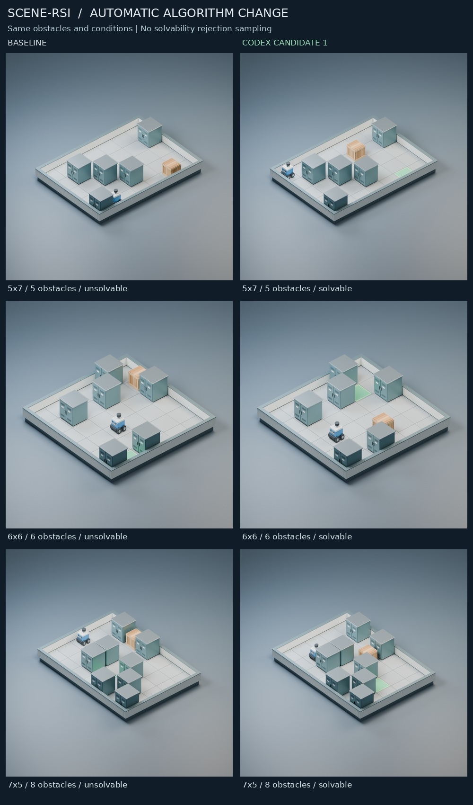

# 第一次真实 Codex 场景生成算法改进实验

以 `19bb4db` 为起点，使用现有服务器、原条件与 seeds 完成。真实模型调用 **3 次**，产生三个算法文件候选；候选 1/3 通过静态审计和受限执行，候选 2 静态拒绝、未执行。固定控制器自动选择 **候选 1**。独立 val 可解率从 **19/96 到 96/96**，`require_solvable=False`，没有可解性 oracle 拒绝采样。

这是当前室内单方块推动任务族的**自动生成算法修改与任务级改进**，不是 RSI。Codex 模型、提案提示、反馈结构、预算和选择规则在三次成功推理期间保持固定；没有模型训练或 Meta-Agent 自修改。

## 实际修改与接口

候选只修改 `scene_rsi/agent/world_generator.py` 中的 `layout(packet)`。受信任控制器在外部用原 RNG 生成 sample，候选保留 `sample[:-3]` 的整张静态障碍地图，只决定 Agent、箱子和目标的通用放置。输出是四个结构化字段；SceneSpec/SceneState 由原 `make_task()` 在候选环境外构造和验证。候选源码从不在宿主导入。

选中代码约 180 行：先枚举局部可推动、可转向的几何结构，再延长一条构造路线，并把 Agent 放在首个推动位置可步行到达的区域。它只搜索局部几何和普通步行连通性，没有复制完整 `(agent, crate)` 联合状态求解器，没有生成完整场景后调用 oracle 反复淘汰。采样坐标导出的确定性混合只用于位置多样性，不是完整性校验。

原 `scene_rsi.world.task.generate()` 保留为精确基线；新算法通过 `scripts/generate_selected_scene.py` 的受限入口使用。原 UI 仍用旧生成器，没有把模型代码接到宿主 UI 进程。SceneSpec、Verifier、求解器、物理规则、固定测试 Agent、原基准、保留测试和 Blender 渲染器均未修改。没有新增哈希校验、自定义版本字段、VLM 或神经渲染训练。

新增代码仅包含本次协议/审计、现有 Apptainer 的单进程入口、凭据外置的提案转发、固定实验/复现脚本，以及生成和渲染入口。它不是通用隔离框架，旧 P2A/P2B 的通用候选接口仍保持原状。

## 冻结设计与独立评价

- dev：6×6/6、7×5/8、5×7/5，seeds 2000..2031；val：4×4/3、6×8/10、8×6/12，seeds 90000..90031；每个模式各 96 任务。直接复用 `19bb4db` 的条件和计数，没有改数据。
- 原始生成器复现 dev 26/96、val 19/96；新受限布局协议也逐项使用同一 RNG 采样顺序，复现相同计数。最短距离不足 2 的共同几何门槛保留，最多 256 次原始提案；关闭可解性筛选。
- Codex 只获得基线源码、dev 聚合指标、原始 dev 成败场景，以及前面候选的 dev 聚合反馈。没有 val 条件/逐项结果、控制器日志、参考路线或人工编写的缺陷修复提示。候选没有 seed ID，只有当前房间条件和随机坐标 sample。
- 所有三次提案结束后才评价候选 val。原独立搜索和 PyBullet 参考重放在候选环境外运行。模型、候选输出和视觉渲染均不能给自己打分。
- 选择规则在调用前提交：dev/val 几何全部有效，val 可解率严格高于基线，每组唯一布局比例至少 .9，所有可解任务通过物理参考重放；按 val 可解数、dev 可解数、val 最短动作均值依次选择。没有按结果改规则。

## 候选与对照

| 版本 | 静态审计 | dev 可解 | val 可解 | dev/val 固定 Agent 完成 | 结果 |
|---|---|---|---|---|---|
| 基线 | 可信原代码 | 26/96 | 19/96 | 19/96、9/96 | 保留 |
| 候选 1 | 通过 | 96/96 | 96/96 | 65/96、73/96 | 选中 |
| 候选 2 | 拒绝：nonlocal | 未运行 | 未运行 | 未运行 | 原样归档 |
| 候选 3 | 通过 | 96/96 | 96/96 | 64/96、63/96 | 未选中 |

候选 1 和 3 的几何有效率均为 192/192，所有可解结果的原始 PyBullet 参考路线重放通过。两者 val/dev 可解数相同，候选 1 的 val 最短动作均值更高，因此按既定规则胜出。候选 2 使用 `nonlocal serial`，触发预先固定的保守审计；这不等于证明代码恶意，也没有人工豁免或修改后重评。它仍有完整原始输出、Diff 和独立 Git 提交。

| 版本 | Git 提交 |
|---|---|
| 候选 1 | `753b7b19610842407b8f150a455e0708485c5daf` |
| 候选 2 | `ebec28ae90449217b143d70e8d730b1bc18902b4` |
| 候选 3 | `669ebd6f50fc2350361187f4154c909e27ac072c` |

### 收益来源、难度与多样性

选中算法 dev/val 都是 **96 个原始 sample 得到 96 个场景**，没有重试；基线分别使用 105/111 个 sample，其中 9/15 次仅因距离门槛被拒绝。可解性 oracle 筛选次数均为 0。提升来自新的构造式放置算法，同时伴随更多几何计算和不同的任务分布，不是免费提升。

为排除“接受了不同障碍地图”的影响，选择结束后额外固定每个基线已经接受的**完全相同障碍图**，让候选 1 只输出一次：dev/val 仍各为 96/96。这个补充检查不参与选择，也不传回模型，数据在 `results/matched_maps/`；val 逐项数据保留在服务器控制目录。

| 版本 | dev 平均生成 ms | val 平均生成 ms | dev/val 可解样本最短动作均值 | dev/val 运行时 CPU 秒 |
|---|---|---|---|---|
| 基线 | 0.383 | 0.400 | 11.58 / 15.16 | 1.910 / 1.904 |
| 候选 1 | 1.600 | 1.412 | 10.82 / 9.94 | 2.023 / 2.029 |
| 候选 3 | 2.228 | 2.374 | 9.45 / 9.21 | 2.141 / 2.066 |

生成毫秒包含相同管道传输、候选调用和外部几何验证，不含独立求解/物理评估和容器启动。CPU 秒包含每条件 Apptainer 启动及等待回收的子进程，不混入宿主独立评价；RSS 字段是控制器生命周期子进程高水位，不能当作每个候选的内存峰值。硬上限是独立记录的 256 MiB 地址空间。

不能把 96/96 解读为同等难度、同等多样性的全面改善。基线 val 只有 19 个可解样本，最短路线均值 15.16；选中版本 96 个可解样本均值 9.94，两者条件分布不同。候选没有把所有任务变成两步推箱，但它倾向局部可构造路线，任务难度和箱子位置分布都偏移了。Fixed Agent 没有改进；其更高完成率反映新场景分布。

| val 条件 | 版本 | 唯一布局 / 32 | 障碍 Jaccard 距离 | 箱子位置经验熵 bits | 最短动作均值（可解样本） |
|---|---|---|---|---|---|
| 4×4/3 | 基线 | 32 | 0.867 | 3.554 | 7.75 |
| 6×8/10 | 基线 | 32 | 0.875 | 4.562 | 18.50 |
| 8×6/12 | 基线 | 32 | 0.845 | 4.601 | 14.40 |
| 4×4/3 | 候选 1 | 32 | 0.868 | 2.084 | 7.75 |
| 6×8/10 | 候选 1 | 32 | 0.874 | 4.203 | 11.22 |
| 8×6/12 | 候选 1 | 32 | 0.847 | 3.804 | 10.84 |

每组 32 个样本没有重复，不足以证明充分多样性。尤其 4×4 的箱子位置熵从 3.55 降到 2.08 bits。独立 val 用于三选一，尚未运行额外未参与选择的 test，所以这里的跨条件结果仍有选择偏差和小样本限制。

## 实际调用与费用记录

使用现有配置的 `gpt-6.1-sol`，Codex CLI 0.163.0。三个真实模型请求均返回 HTTP 200、结构化代码与理由，以及实际 token 统计；模型没有执行本地工具。

| 候选 | 输入 tokens | 输出 tokens（含推理） | 合计 tokens | 调用秒 |
|---|---|---|---|---|
| candidate_1 | 14240 | 3617 | 17857 | 110.33 |
| candidate_2 | 14783 | 3343 | 18126 | 80.94 |
| candidate_3 | 14801 | 4113 | 18914 | 122.04 |

合计 **43,824 输入 + 11,073 输出 = 54,897 tokens**。使用现有 ChatGPT-plan 凭据，接口没有返回美元账单，金额记录为 null，没有估算成实际扣款。

另有 3 次 CLI exec 在 DNS 阶段失败，没有取得上游 HTTP 响应或产生模型推理，原日志保存在 `transport_failures/`；随后只修正外部 HTTPS 代理并在传输失败时立即停止。还有 1 次明确标记的本机 SSE 传输样例。故 CLI exec 共 7 次，成功真实模型调用和算法提案各为 3 次；版本查询不计入 exec。没有隐藏这些失败或把离线样例计入 token 成本。三次成功推理统一使用固定控制器父提交 `5439dbbdf68273d23ceb2d44135b8de513e1b32b`。

## 受限执行的实际边界

没有重新搭建服务或安装新容器工具，复用其他项目已有 Apptainer 与 SIF。原 cgroup v2 委派问题仍存在；这里采用更窄的内核限制：在任何候选代码执行前禁止 fork/vfork/clone/clone3 和 exec，连线程也不允许，因此候选始终只有一个进程，CPU/地址空间硬上限就是其全部后代资源上限。

- 私有挂载、PID/IPC/网络空间，非特权用户，无宿主 Home/仓库/评价器/数据/凭据挂载；最小 `/dev` 没有 GPU。
- 候选载入前安装 no_new_privs + seccomp：文件打开、写文件/目录、网络 socket、进程/线程创建、挂载/namespace、提限等系统调用被内核拒绝。不是靠 Prompt、Python AST 或普通 cwd 隔离。
- 单进程 256 MiB 地址空间、5 秒累计 CPU/32 任务条件、30 秒 wall time、7 秒响应时限；stdout 流式限制 1 MiB/条件、单行 16 KiB，stderr 64 KiB，超限终止并回收。候选无可写文件，文件大小硬限制为 0。
- 八项真实回归均通过：私有文件/凭据读取、网络、fork、写评价器、提高限制、内存耗尽、输出洪泛和无限循环。失败初始化绝不降级到宿主 Python。记录在 `checks/security-acceptance.json`。
- Codex 提案进程也在独立容器，只挂 dev 请求和新输出目录，通过私有网络中的桥接访问一个受限 Unix socket。真实令牌只由宿主转发器读取，候选与提案文件系统/环境中均没有它；外发仅固定模型的一个 Responses 请求，512 KiB 请求上限、8192 输出 token 和 180 秒时限。服务端不提供工具，CLI 又禁止子进程，不能读取完整项目或 val。

这些边界仅针对这个纯 Python 结构化布局协议；没有声称旧任意 Python/P2B 通用执行系统全部完成。

## 复现与使用

现有服务器上的路径不变；需要原 world Python 环境、已验收的 Apptainer/SIF，以及渲染时的 Blender 4.2.0。

```bash
cd /srv/lab-disks/disk2/users/xymo/rsi/scene_rsi_phase2
WORLD_PY=/srv/lab-disks/disk2/users/xymo/rsi/world_run/env/bin/python
export OPENBLAS_NUM_THREADS=1 OMP_NUM_THREADS=1
CUDA_VISIBLE_DEVICES= "$WORLD_PY" -B -m unittest discover -s tests -v

# 使用归档的三个提案，重新验收与完整评价；不再调用模型。RUN 必须是新的。
RUN=/tmp/scene-algorithm-replay
"$WORLD_PY" -B scripts/check_layout_isolation.py --out "$RUN/security"
CUDA_VISIBLE_DEVICES= "$WORLD_PY" -B scripts/run_algorithm_experiment.py --run "$RUN" \
  --replay experiments/first_algorithm/results/attempts

# 生成一个新场景：仍走受限执行，完全没有可解性筛选。
"$WORLD_PY" -B scripts/generate_selected_scene.py --seed 2000 --out /tmp/selected-scene-new.json
"$WORLD_PY" -B -m scene_rsi.world evaluate --task /tmp/selected-scene-new.json --out /tmp/selected-result-new.json

# 重渲染三个固定 dev seed 的同障碍前后对照；选择当时空闲的 GPU。
BLENDER=/srv/lab-disks/disk2/users/xymo/projects/bvb-repro/runtime/blender-4.2.0-linux-x64/blender
"$WORLD_PY" -B scripts/render_algorithm_comparison.py --run experiments/first_algorithm/results \
  --out /tmp/algorithm-renders-new --blender "$BLENDER" --gpu 1
```

实测完整测试 **164/164 通过**。另外一次完整归档重放仍选候选 1，dev/val 同为 96/96，模型调用 0 次。选定算法生成的 JSON 已实际交给原 world evaluate 入口，参考重放及 Fixed Agent 均完成。

如需重做真实提案，用新的 RUN、同一安全验收命令，再运行 `scripts/run_algorithm_experiment.py --run "$RUN"`（不带 replay）；它会消耗模型调用并建立三个候选分支；应在新的 clone 中检出固定控制器 `5439dbb` 后运行，以保留原始生成器父版本并避免候选分支重名。

完整 val 逐项结果、任务与参考重放留在 `../first_algorithm_run/experiment/`；Git 中只保存 val 聚合统计。开发集记录、全部候选代码/原始输出/Diff/Git 版本/审计/成本/请求、独立汇总及复现记录在本目录。

## 实际渲染

三个代表性条件固定选取首个 dev seed 2000，不按画面或成绩挑图。每对使用完全相同障碍地图，前后只改变角色/箱子/目标的生成算法。原有 A100 + Blender 4.2.0 / Cycles CUDA 实际生成 6 个场景 × 3 相机 = **18 张 PNG**，并有 6 个 `.blend`、6 个 `.glb`。六个文件对已实际回读，包围盒、材质、相机均通过验收。图像不参与任何评分。



结论：当前推动任务族在冻结的新尺寸/密度条件上，首次有效输出的可解率得到实测提升；来源是 Codex 自动写出的通用构造算法，同时付出了更多计算并改变了难度和位置多样性。没有可解性拒绝采样，没有改评价规则，也没有真正的 RSI 证据。
