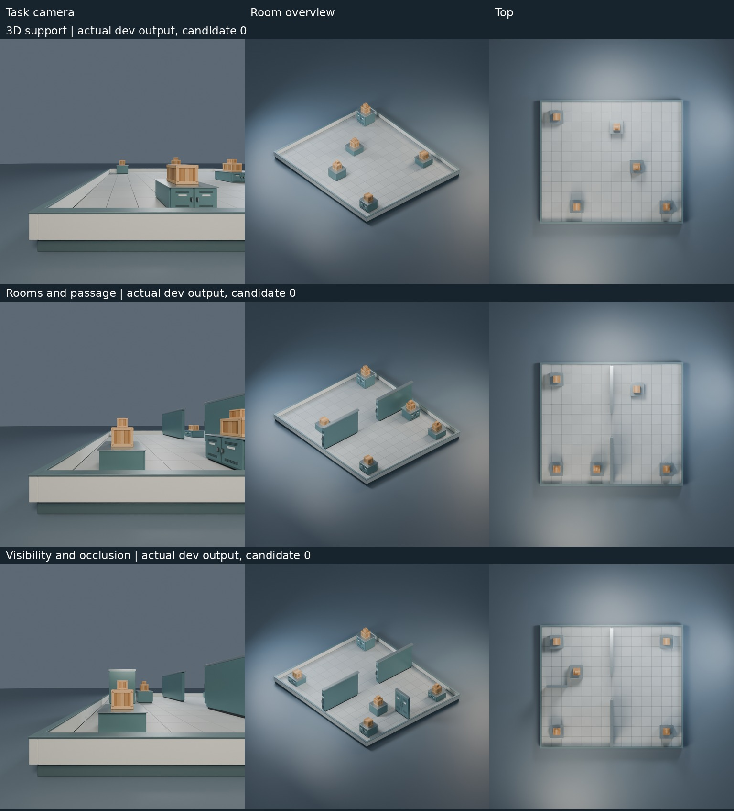

# 3D 任务与探测机制可行性实验

从 `766382c` 开始。任务、检查器、M0/M1 边界与原始实验协议在
`7952b9c`、真实模型调用之前冻结；后续没有修改评分规则或任务。
**3D 生成与渲染链路可运行，但本次仍未形成有区分度的元策略评测，未启动 M2。**



## 实现和边界

- 原 SceneSpec、SceneState、SceneVerifier、walk 求解器、旧基准与资产库不变。
  新任务响应为 `{state: SceneState, elevations: {id:z}}`，不改变旧场景的地面语义。
- 支持 3D 支撑、规定高度、两房间与门洞、联合物体间距、入口到目标通行，
  以及固定相机下同时可见/隐藏目标。使用现有 crate/obstacle Mesh，
  6/10/13 个可移动物体，最多三层堆叠；每个任务有不提供给模型的合法参考场景。
- 原 Verifier 检查地面投影；独立扩展检查器检查全部 3D 包围盒、支撑接触及
  5cm 支撑余量、房间、间距、相机射线和通行，PyBullet 独立检查穿透。
  .5m 通行网格避免跳过 .3m 薄隔墙；旧求解器未改。
- 候选只收到任务 JSON，输出一次场景。沿用 Apptainer + seccomp/RLIMIT：
  无外网/Home/凭据/GPU，256MiB、5 CPU 秒、7 秒响应时限、输出有界。
  没有普通宿主 subprocess 降级，没有人工逐个修复或批准候选。
- 高度从有限姿态域选择，物理和可见性使用实体包围盒代理，不是任意 Mesh
  接触动力学、像素分割或自由连续空间生成。相机射线不参与旧任务的正确性评分。

## 校准与冻结

独立校准集 27 张。最初没有联合距离约束时，简单搜索 25/27，过易；
在任何模型调用之前增加联合距离约束。随后薄墙回归发现 1m 网格漏检，
在调用之前改用 .5m 网格。所有校准结果均保存，没有用 M0/M1 成绩调任务。

| 冻结算法 | 校准成功 | 最终保留集成功 |
|---|---:|---:|
| 原 FixedSceneAgent，原样运行，高度为 0 | 0/27 | 0/27 |
| 新任务初始 greedy | 1/27 | 1/27 |
| 新任务初始 independent | 0/27 | 1/27 |
| 简单深度优先约束搜索，2,000 节点 | 9/27 | 9/27 |

原 FixedSceneAgent 没有新高度/支撑接口，不能作为已有 3D 能力的强基线。
最终保留集的简单搜索平均首次输出 32.72ms；候选 0 为 25.75ms，
二者都包含请求传输，不含容器启动。其余成功候选为 20.83–38.82ms。
该耗时不适合精确性能排名，容器启动、物理和检查器成本另记。

dev/selection/test 种子、地图尺寸、共同开发任务与三个固定等额探测池见
[原始协议](PROTOCOL.md)。选择集 18 张，终测 27 张；模型只接收 dev。
只按硬约束成功数选择，地面有效性仅打破精确平分，平分保留更早版本。
元策略源码保持冻结，只交换 choose 阶段使用的程序，诊断和提案策略不交换。

## 实际首轮结果

实际 **8 次 Codex CLI / 8 次上游调用**，同一 gpt-6.1-sol、medium、
8,192 输出 Token、180 秒调用时限。7 份完整 JSON 代码提案，6 个静态通过；
这 6 个候选均隔离执行成功，分别达到 dev 12/12、selection 18/18、test 27/27。

MetaImp@1 定义为终测成功率减去初始成功率。以下为每个初始生成器一次采样，
不是重复采样均值或独立任务置信区间。

| 组 | 完整提案 | 静态通过/完整提案 | greedy 终测 | independent 终测 | 平均 MetaImp |
|---|---:|---:|---:|---:|---:|
| M0 | 2/2 | 2/2 | 27/27 | 27/27 | 0.9630 |
| M0 + M1 探测 | 1/2 | 1/1 | 1/27 | 27/27 | 0.4815 |
| M1 + random 探测 | 2/2 | 1/2 | 27/27 | 1/27 | 0.4815 |
| M1 | 2/2 | 2/2 | 27/27 | 27/27 | 0.9630 |

失败为 c1 提案超时、c5 第 7 行 `unmatched ']'`，没有手工修复。
所有通过审计候选的算法质量均满分，无法依此排列元策略的算法改进能力。
两组 MetaImp 值分别为 `[.9630,.9630]` 和 `[0,.9630]`（或逆序），
跨初始程序样本标准差为 0 和 .6809，不能解释为独立模型采样的不确定性。

**首轮四组实际都选了 random，因此没有发生有效的探测机制分叉。**
同一提案策略的任务、场景和失败反馈相同，仅实测延迟等测量值有差异。
合并实际使用的 M0/M1 提案策略后，各有 3/4 次成功改进，平均 MetaImp 均 .7222。
不能把一次超时或语法错误解释为自适应探测的因果收益。

合成诊断的独立机制测试验证：M0 始终 random，M1 在低/中/高可靠性时
分别 random/barriers/dense。部分第二轮准备确实触发 M1 dense，但在两个
已成功生成器上仍为 6/6，没有暴露新失败；没有为该轮发出模型请求。
这说明选择机制能运行，不能证明它改善算法提案。

### 提前停止的协议偏离

原预注册规则要求所有 8 条轨迹选择集 >=90% 才停止；因超时/静态失败，
该规则没有触发。按用户“算法再次接近满分就停止增加调用”的更高优先级要求，
在观察到 6/6 审计通过候选满分后，提前中断第二轮准备，仅完成预定终测。
这是**探索性提前停止**，不是预注册主要规则成功触发。
原 `ceiling_stop.json`（false）和 `early_ceiling_stop.json` 均保存，
另有 72 次开发任务执行的未完成第二轮准备成本，未算作 K=2 或新模型调用。
终测没有用于继续修改任务、选择算法或启动 M2。

## 成本、渲染与结论

| 组 | 可用 Token 总量 | 缺失用量调用 | 上游累计秒数 |
|---|---:|---:|---:|
| M0 | 89,584 | 0 | 300.18 |
| M0 + M1 探测 | 44,057 | 1 | 270.72 |
| M1 + random | 223,238 | 0 | 229.54 |
| M1 | 221,701 | 0 | 205.75 |

已知合计 **578,580 Token，1 次超时用量未知**，不能当作完整成本或据此
作精确 Token 归一化排名；没有美元账单数据。提案可并发，上游时间不可相加
当作实验墙钟时间。主实验及终测 933.06 秒，包含提前停止期间的准备和等待，
不含开发、校准、补充基线、离线复核与渲染。分阶段 CPU 与未完成准备开销在
[execution_costs.json](results/pilot/execution_costs.json)，RSS 为子进程历史高水位，
不是独立候选峰值。

候选 0 增加了弧一致性、最小剩余域分支和低约束值排序，同时把内部搜索节点上限
提高到 24,000；是通用算法修改，不是单场景编辑或两个布尔参数。但无法把收益
完全分解为传播策略与更高内部搜索额度；所有候选仍受相同 5 CPU 秒硬上限约束。
没有外部可解性拒绝采样、可信求解器导入或参考解反馈。

最终 54 个隐藏目标的全部采样点都在相机视锥内且被遮挡，未靠出画通过。
各 family/tier 的 18 个候选输出仅有 2–9 个不同几何布局（忽略匿名 id 和
方形物体朝向），模板与有限域仍明显限制多样性。该任务足以区分弱贪心与
约束传播程序，**不足以区分 M0/M1 的元级改进能力**；不宣称完整 RSI，不生成 M2。

3 个渲染样例为候选 0 真实 dev 输出，按“各族成功场景中物体最多”固定规则选取，
不是隐藏参考解或终测挑图。已有 3 个 `.blend`、3 个 `.glb`、9 张 PNG；
回读确认 44 个资产包围盒与 3D 状态匹配、三相机、材质和光照均保留。
使用原 Blender 4.2.0 CPU、4 线程、768px、24 samples。渲染前 8 张 A100 均在
运行其他任务，未占用其 GPU；实际后端与资源以各 `result.json` 为准。

202 项完整测试通过；8 项真实隔离恶意行为回归通过；627 条保存场景重评分一致，
该复核没有模型调用或候选代码执行。
公开归档只含 selection/test 汇总，逐项状态保留在服务器私有运行目录。
请求隐私检查覆盖 36 个请求、212 个开发包，对 45 个保留包发现 0 次泄露。

## 复现

服务器现有环境，无 GitHub Actions；`requirements-world.txt` 包含所需依赖。
下列目录须使用新路径，已有真实运行保留在 `/srv/lab-disks/disk2/users/xymo/rsi/meta_3d_run`。

```bash
cd /srv/lab-disks/disk2/users/xymo/rsi/scene_rsi_phase2
PY=/srv/lab-disks/disk2/users/xymo/rsi/world_run/env/bin/python
export OPENBLAS_NUM_THREADS=1 OMP_NUM_THREADS=1 CUDA_VISIBLE_DEVICES=''
$PY -B -m unittest discover -s tests
$PY -B scripts/check_layout_isolation.py --out /tmp/spatial_repeat/security
$PY -B scripts/calibrate_spatial.py --out /tmp/spatial_repeat/calibration --security /tmp/spatial_repeat/security
# 以下真实消耗账户配额：最多八次新模型调用，必须有原受限环境和宿主代理认证。
$PY -B scripts/run_spatial_ablation.py --pilot-only --run /srv/lab-disks/disk2/users/xymo/rsi/meta_3d_repeat --security /tmp/spatial_repeat/security --calibration /tmp/spatial_repeat/calibration
```

`--pilot-only` 是交付时新增的八次调用复现开关；原运行先按预注册控制器启动，
后显式停止，完整记录未覆盖。模型随机性意味着新提案和成绩不保证逐字重复。

无需模型、无需候选执行的原始 JSON 重评分：

```bash
$PY -B scripts/replay_spatial_scores.py --run /srv/lab-disks/disk2/users/xymo/rsi/meta_3d_run/live --out /tmp/spatial_score_replay.json
```

私有原始记录不在 GitHub。仅凭公开仓库重测某个已归档程序，仍须通过隔离验收：

```python
from pathlib import Path
from scene_rsi.benchmark.spatial_tasks import dataset, evaluate
source = Path('experiments/spatial_probe/results/pilot/c0/source.py').read_text()
evaluate(source, [c for c, _ in dataset('test', 3)], Path('/tmp/spatial_eval/results'), Path('/tmp/spatial_eval'))
```

对新运行的 dev 输出渲染；省略 `--gpu` 使用 CPU，有独占空闲卡时可传其 UUID：

```bash
$PY -B scripts/render_spatial_samples.py --run /srv/lab-disks/disk2/users/xymo/rsi/meta_3d_run/live --slot 0 --out /tmp/spatial_render_repeat --blender /srv/lab-disks/disk2/users/xymo/projects/bvb-repro/runtime/blender-4.2.0-linux-x64/blender
```

原始调用、补丁、预算、dev 反馈、私有评价汇总、成本及停止依据均在
[results/pilot](results/pilot)。所有候选仅作为数据执行，不要直接 import 或在宿主运行。
